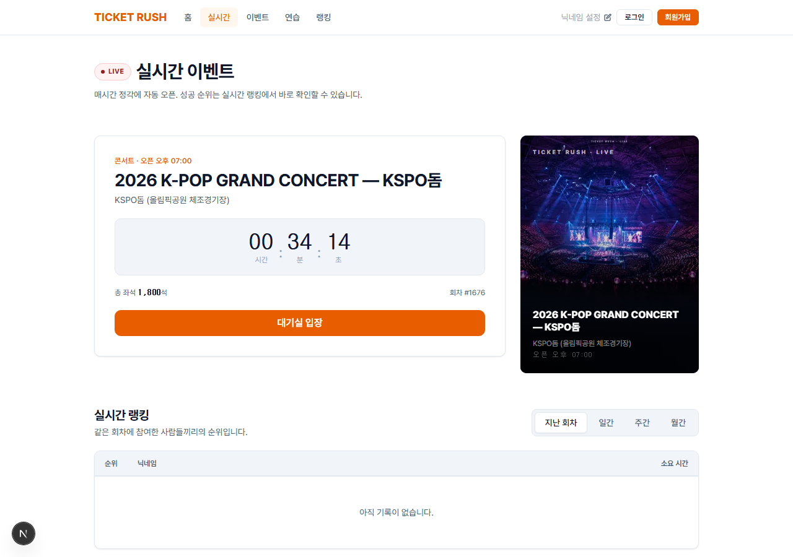
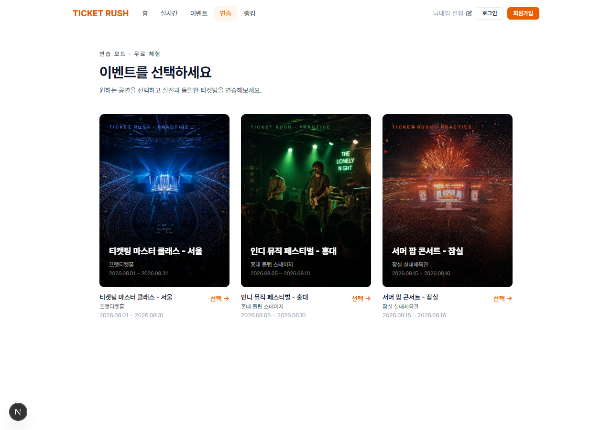
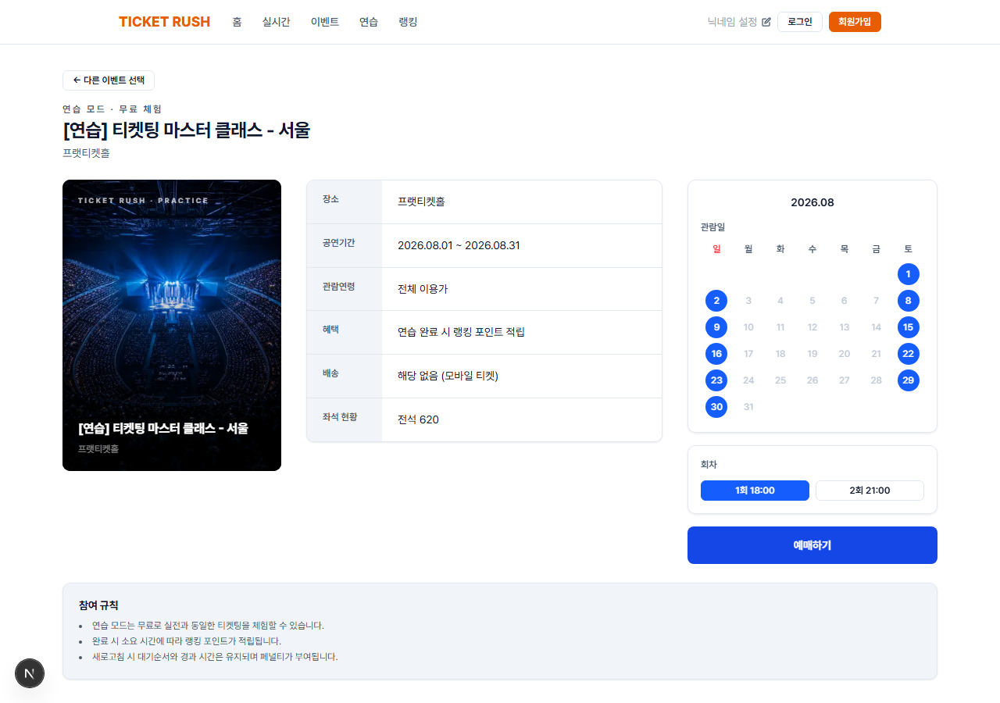

# TICKET RUSH — Frontend

<p align="center">
  
  
  
  
  
</p>

> 백엔드 저장소: [Ticketing_be](https://github.com/tjdalsquf8/Ticketing_be)

---

## 서비스 소개

실전과 똑같은 좌석 선택·대기열·좌석 점유 흐름을 연습하고, 매 정각 열리는 **무료 실시간 티켓팅**에서 다른 참가자와 속도를 겨루는 티켓팅 트레이닝 서비스. 1인 개발.

| 기존 방식 | TICKET RUSH 사용 후 |
|---|---|
| 티켓팅은 실전 한 번뿐이라 연습할 방법이 없음 | 실전과 동일한 흐름의 연습 모드를 언제든 무료로 체험 |
| 내 클릭 속도가 어느 정도인지 비교할 기준이 없음 | 소요 시간 기준 일간·주간·월간 랭킹 제공 |
| 실제 공연장 좌석 배치를 모르고 들어감 | 실제 공연장 10곳의 구역·좌석 배치도를 본뜬 좌석 맵 |
| 오픈 순간 접속이 몰려 대기열에서 막막함 | 서버 시각 기준 카운트다운 → 대기실 → 실시간 대기 순번 안내 |

---

## 화면 소개

<table>
  <tr>
    <td align="center">
      <br/>
      <sub>실시간 이벤트 — 다음 회차 카운트다운 · 대기실 입장</sub>
    </td>
    <td align="center">
      <br/>
      <sub>연습 모드 — 공연 선택</sub>
    </td>
    <td align="center">
      <br/>
      <sub>연습 모드 — 공연 상세 · 회차 선택</sub>
    </td>
  </tr>
</table>

---

## 주요 기능

- **실시간 티켓팅** — 매 정각 자동 오픈되는 회차(5분 진행). 서버 시각과 동기화한 카운트다운 → 대기실 → 좌석 선택 → 결과까지 한 흐름
- **실시간 대기열 / 좌석 현황 (SSE)** — 내 대기 순번과 다른 참가자의 좌석 점유·확정 상태를 새로고침 없이 반영. `fetch` 기반 SSE 클라이언트로 재연결·실패 분기를 직접 처리
- **공연장별 좌석 맵** — 실제 공연장 10곳(KSPO돔, 고척스카이돔, 잠실 야구장, SSG랜더스필드, 인스파이어 아레나, 잠실 주경기장, 블루스퀘어, 세종문화회관 대극장, YES24 라이브홀, 한강 페스티벌)을 아레나 링·야구장 다이아몬드·타원형 스타디움·프로시니엄 등 배치 유형별 SVG 컴포넌트로 구현
- **연습 모드** — 로그인 없이 체험 가능한 연습 세션. 캡차 입력, 소요 시간·등수·백분위 확인
- **랭킹** — 소요 시간 기준 연습/실시간 모드, 일·주·월·전체 기간 필터, 내 순위 표시, 무한 스크롤
- **이벤트** — 이벤트 목록·상세·캘린더, 참여 신청, 종료 후 결과 보드
- **게스트 · 회원** — 가입 없이 게스트 닉네임으로 참여, 이메일 회원가입/로그인, 마이페이지(참여 이력·기프티콘)
- **관리자 콘솔** — 이벤트 CRUD, 실시간 회차 운영·설정, 기프티콘 재고, 정산 이력, 공지사항 관리
- **인증/보안** — httpOnly 쿠키 인증 + 401 시 자동 refresh(single-flight), `/admin`·`/my` 미들웨어 1차 방어 + 관리자 라우트 404 마스킹, HTTP 보안 헤더

---

## 기술 스택

| 분류 | 기술 |
|---|---|
| Language | TypeScript |
| Framework | Next.js 16 (App Router), React 19 |
| Styling | Tailwind CSS v4, 디자인 토큰(`src/styles/tokens.ts`), Pretendard |
| State | React Context (`AuthContext`) + 커스텀 훅 |
| 실시간 | SSE (`fetch` 스트림 기반 커스텀 클라이언트) |
| 인증 | httpOnly 쿠키(access / refresh), 게스트 UUID 쿠키 |
| Lint | ESLint 9 (`eslint-config-next`) |

---

## 아키텍처

```
[Browser]
    │
    ▼
[Next.js — App Router]      ← 페이지 · 컴포넌트 · middleware(/admin, /my 가드)
    │
    ├── REST  (src/lib/api.ts ROUTES, 401 → refresh → 재시도)
    └── SSE   (src/lib/sse.ts → 대기열 / 좌석 스트림)
    │
    ▼
[Express API — Ticketing_be]
    ├── PostgreSQL   ← 회원 · 회차 · 좌석 · 랭킹
    └── Redis        ← 대기열 · 좌석 점유 · 활성 세션
```

- API 엔드포인트는 `src/lib/api.ts`의 `ROUTES` 한 곳에서만 관리
- 인증 상태는 `AuthContext`에서만 관리하고, 라우트 전용 컴포넌트는 `src/app/**` 옆에, 재사용 컴포넌트만 `src/components/**`에 배치

---

## 폴더 구조

```
FE/
├── src/
│   ├── app/            라우트 (홈 · live · event · practice · ranking · my · admin · login/signup · notices)
│   ├── components/     booking(좌석 맵) · live · ranking · event · admin · layout
│   ├── contexts/       AuthContext
│   ├── hooks/          useQueueStream · useSeatsStream · useServerTime
│   ├── lib/            api(ROUTES) · sse · 도메인별 API 래퍼
│   ├── data/           공연장 좌석 배치 데이터 (live 10곳 · practice)
│   ├── styles/         디자인 토큰
│   ├── types/
│   └── middleware.ts   /admin · /my 1차 접근 제어
├── public/Img/         공연장 · 포스터 이미지
├── READMEIMG/          README 스크린샷
```
